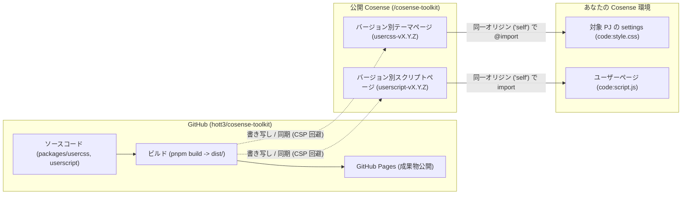

# cosense-toolkit

> Scrapbox (Cosense) を最高に快適な思考・執筆環境にするための統合ツールキット（UserCSS / UserScript / 拡張基盤）

[](https://github.com/hott3/cosense-toolkit/actions/workflows/deploy.yml)

---

## 概要

`cosense-toolkit` は、Cosense（Scrapbox）を「直感的な思考をどんどん形にできるノート」へと進化させるためのモノレポです。
光学ガラス（Pure Optical Glass）のデザインシステム、動的テーマスイッチャー、表面張力リップル演出、そして将来の Chrome 拡張機能やモバイル向けクイック入力・Agent Skills までを unified に管理・配信します。

---

## 全体構成・配信の仕組み

`scrapbox.io` の Content Security Policy (CSP) により外部ドメイン（`github.io` 等）からの CSS / JS 読み込みはブロックされるため、ビルド成果物を **公開 Cosense プロジェクト（[`/cosense-toolkit`](https://scrapbox.io/cosense-toolkit/)）** に同期し、各プロジェクトからは同一ドメイン（`/api/code/cosense-toolkit/...`）として読み込む構成を採用しています。



---

## ディレクトリ構成

```text
cosense-toolkit/
├── packages/
│   ├── usercss/              # UserCSS テーマ群 (Pure Optical Glass, Daylight, Clean)
│   │   ├── src/
│   │   └── scripts/build.mjs
│   └── userscript/           # TypeScript 製 UserScript (4層アーキテクチャ)
│       ├── src/
│       │   ├── domain/       # 純粋関数・型・定数 (DOM 非依存)
│       │   ├── infrastructure/ # Storage / Cosense API / DOM UI シェル
│       │   ├── features/     # 独立機能スライス (Theme / Fluid / Ripple / SearchTools / PageTemplates / TodayPageMarker)
│       │   ├── application/  # 起動・ON/OFF 設定・依存配線
│       │   └── index.ts
│       ├── tests/            # Vitest + happy-dom + アーキテクチャ境界テスト
│       ├── vitest.config.ts
│       └── scripts/build.mjs
├── apps/                     # （将来拡張）Chrome 拡張機能 / モバイル PWA
├── skills/                   # （将来拡張）Scrapbox 連携 Agent Skills
├── dist/                     # GitHub Pages 配信成果物 (自動ビルド)
│   ├── usercss/
│   │   ├── index.json        # テーマ一覧マニフェスト
│   │   └── <theme-id>/style.css
│   └── userscript/
│       ├── script.js
│       └── script.min.js
├── mise.toml                 # Node 24 + pnpm 管理
├── pnpm-workspace.yaml
└── README.md
```

---

## 収録テーマ

1. **Pure Optical Glass（Night / Default）**
   - 深夜の漆黒（`#04080F`）と極薄ガラス板（透過率ゼロ塗りの屈折枠・シャンパンゴールド文字）。
   - 3層の流動ライトプールと、カード押下時の表面張力リップル（弾性変形）を搭載。
2. **Frosted Daylight（Day / Light）**
   - 昼光を浴びたフロストガラス（シルキーパール `#EFF4FA`、スカイブルー・アンバーの屈折光）。
3. **Modern Clean（Classic）**
   - 視覚効果をオフにし、白背景と最小限の枠線でテキストに集中できるクラシックテーマ。

---

## Scrapbox への導入方法

### 1. テーマの読み込み (`settings` または個人ページ)
プロジェクトの `settings`（または個人ページ）の `code:style.css` に、バージョン固定ページを指定して記載します（初期テーマとして Pure Optical Glass を読み込む場合）：

```css
/* Google Fonts */
@import url('https://fonts.googleapis.com/css2?family=Inter:wght@400;500;600;700&display=swap');

/* Default Theme: Pure Optical Glass (公開 Cosense プロジェクト / パッケージバージョン固定) */
@import url('/api/code/cosense-toolkit/usercss-v0.2.1/pure-optical-glass.css');
```

### 2. UserScript の読み込み（ユーザーページ）
ご自身のユーザーページ（例: `hott3`）の `code:script.js` に以下を記載します：

```javascript
import '/api/code/cosense-toolkit/userscript-v0.4.0/script.js';
```

読み込むと以下の機能が有効になります（すべて `src/application/config.ts` のフラグで制御可能です）：

- **Optical Lens ドック ＆ テーマスイッチャー**：画面右下に常駐し、パレットから瞬時にテーマや流体背景・表面張力リップルを切り替え（設定は `localStorage` に保持）。
- **外部検索メニュー (`search-tools`)**：PageMenu に 6 種の外部検索アクション（Google AI モード、Google 検索、Weblio 辞書［引用文自動挿入付き］、Google Fonts、LyricFind、Let's EMOJI）を追加。
- **ページテンプレート (`page-templates`)**：PageMenu に定型テンプレート 3 種（`:ticketlog`、`日報 YYYYMMDD`、`セミナーレポート`）を出力する項目を追加し、Dock の `Page Templates` モーダルからブラウザ（`localStorage`）へカスタムテンプレートを保存・編集・削除・挿入可能。
- **今日の日報カード強調 (`today-page-marker`)**：当日の `日報 YYYYMMDD` カードへ `.today-page` クラスを付与し、Optical Glass トークンに準拠したバッジ＆ハイライトを適用（SPA 遷移時の再判定対応）。

---

## アーキテクチャ設計と開発ルール

`packages/userscript` は以下の **4層アーキテクチャ** を採用しています。

| 層 | パス | 責務 | 依存制約 |
| --- | --- | --- | --- |
| **Application** | `src/application/` | 起動制御（重複防止）、機能 ON/OFF 設定、Feature 間の配線 | 全層を参照可 |
| **Features** | `src/features/` | 個別機能スライス（`logic.ts` / `ui.ts` / `style.ts`） | `domain/` と `infrastructure/` のみ参照可（**Feature 間の直接 `import` 禁止**・同一 Feature 内分割は可） |
| **Domain** | `src/domain/` | 型定義、定数、純粋ロジック（`theme.ts`, `drift.ts`, `date.ts`） | 外部ライブラリ・DOM（`window`/`document`）非依存 |
| **Infrastructure** | `src/infrastructure/` | `localStorage`、`window.scrapbox` アダプター、共通 UI シェル/トースト | `domain/` のみ参照可 |

### 運用ルール
- **実装前の確認**：新しい Feature を追加・編集する前に、まず `domain/` や `infrastructure/` に再利用できる共通定数・アダプター・UI 部品（トースト等）がないか確認してください。
- **肥大化時の昇格**：Feature 内のロジックが他機能でも再利用可能になったり大きくなったりした場合は、`domain/` または `infrastructure/` へ昇格させて重複を排除してください。
- **境界の自動検証**：`tests/architecture.spec.ts` により Feature 間の直接 `import` 違反が CI で自動チェックされます。
- **パッケージ別バージョニング**：モノレポ内のバージョンはパッケージ単位（`usercss-vX.Y.Z` / `userscript-vX.Y.Z`）で管理し、`/cosense-toolkit` 上でも対応するバージョンページから配信します。

---

## ローカル開発手順

ランタイムとパッケージ管理には **[mise](https://mise.jdx.dev/)** と **pnpm** を使用します。

```bash
# 1. 依存ツールの導入 (Node 24 & pnpm)
mise install

# 2. パッケージ依存のインストール
pnpm install

# 3. ビルド (dist/ に CSS と JS を一括生成)
mise run build
# または
pnpm build

# 4. 型チェック
mise run typecheck

# 5. テスト実行 (単体・結合・アーキテクチャ境界)
mise run test
# または
pnpm test

# 6. 開発監視モード
mise run dev
```

---

## 今後のロードマップ

- [x] モノレポ構造の構築 (`mise` + `pnpm workspaces`)
- [x] テーマ 3 種（Night / Day / Classic）のパッケージ化
- [x] TypeScript 版 UserScript（ドック・テーマ切替・表面張力リップル）の実装
- [x] GitHub Pages 自動配信ワークフローの構築
- [ ] モバイル入力最適化（Quick Capture PWA / ショートカット連携）
- [ ] 自作 Chrome 拡張機能（Web ページのワンクリック Scrapbox 転送）
- [ ] 直感的な思考・音声メモを自動で構造化する Agent Skills

---

## License

[MIT License](./LICENSE) © hott3
